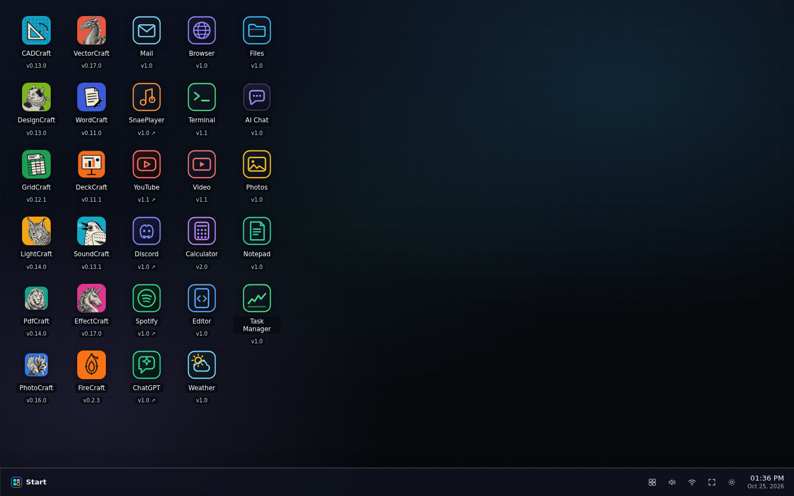

# ArtCraft WebOS

**An experimental, browser-based desktop for running creative apps and exploring a more user-owned operating system.**

[Open the live prototype](https://artcraft-webos.pages.dev/) · [Product vision and roadmap](docs/planning/product-vision.md) · [Report a bug](https://github.com/aliasfoxkde/ArtCraft-WebOS/issues/new/choose)

*The current browser desktop, with its taskbar, windows, and bundled apps.*

## What it is today

ArtCraft WebOS is a useful prototype that runs in a modern web browser. It
provides a desktop-like shell with windows, a taskbar, an app launcher,
settings, and a virtual Files disk. It hosts a collection of bundled
ArtCraft creative apps and includes a terminal with WebAssembly-based
utilities. See the [app guide](docs/getting-started/apps.md) and
[current app registry](docs/reference/craft-apps.md) for details.

You can try it without installing anything at
[artcraft-webos.pages.dev](https://artcraft-webos.pages.dev/). The shell
stores its files and settings in the browser on that device.

### Prototype boundaries

This is not yet a replacement for Windows or Linux, and it is not a
bootable operating system. It does not currently provide user accounts,
cloud sync, or a desktop that follows you between devices. The terminal's
bundled WebAssembly utilities are not a general-purpose sandbox for
uploading and running arbitrary WASM binaries. The bundled apps and shell
also do not yet cover the full range of everyday work that a daily-driver
OS needs.

The in-window browser uses official embeds and cross-origin iframes where
sites permit them. Pages that block framing require a normal browser-tab
handoff. The unsafe same-origin HTML proxy has been disabled rather than
rewriting remote pages under the WebOS origin; see the
[proxy isolation issue](https://github.com/aliasfoxkde/ArtCraft-WebOS/issues/12)
and [security policy](SECURITY.md).

## Where it is heading

The long-term goal is a user-owned computing environment that can follow a
person across devices: a browser experience first, with a possible native
or bootable installation later. The vision includes portable identity and
settings, a safe app and WASM ecosystem, AI-assisted customization, and a
community contribution path where people and agents can propose changes
through reviewable issues and pull requests.

The AI integration model, Page Agent boundary, WASM artifact types, and
community contribution workflow are documented in the
[AI-first architecture](docs/planning/AI-FIRST-ARCHITECTURE.md).

The experimental Browser Agent view in AI Workspace connects to the official
Page Agent browser extension when the user installs and authorizes it; see the
[Page Agent integration notes](docs/planning/AI-FIRST-ARCHITECTURE.md#page-agent-integration).

Those capabilities are goals, not features available today. The
[product vision and phased roadmap](docs/planning/product-vision.md) sets
out the gaps, dependencies, and validation gates. The public
[roadmap issue](https://github.com/aliasfoxkde/ArtCraft-WebOS/issues/13)
tracks the larger direction.

## Get started

For the live demo, open [ArtCraft WebOS](https://artcraft-webos.pages.dev/).
For local development, follow the [setup guide](docs/development/setup.md).
Documentation is indexed in [`docs/README.md`](docs/README.md).

## Contribute

Issues and pull requests are welcome. Start with
[contribution guidelines](.github/CONTRIBUTING.md), the
[code of conduct](.github/CODE_OF_CONDUCT.md), and the
[agent instructions](docs/AGENTS.md). Automated checks run for pull
requests; changes to the browser shell also go through accessibility,
coverage, build, and end-to-end gates.

## Project status

The project is experimental and may change. Browser storage is local to the
browser profile; clearing site data removes it. Review the
[security policy](SECURITY.md) before using the prototype with sensitive
information.

## License and attribution

The first-party shell and repository tooling are licensed under
[MIT](LICENSE). Bundled companion apps and third-party assets may have
separate terms; see [attribution](docs/ATTRIBUTION.md) and each app's own
license before redistributing those components.
